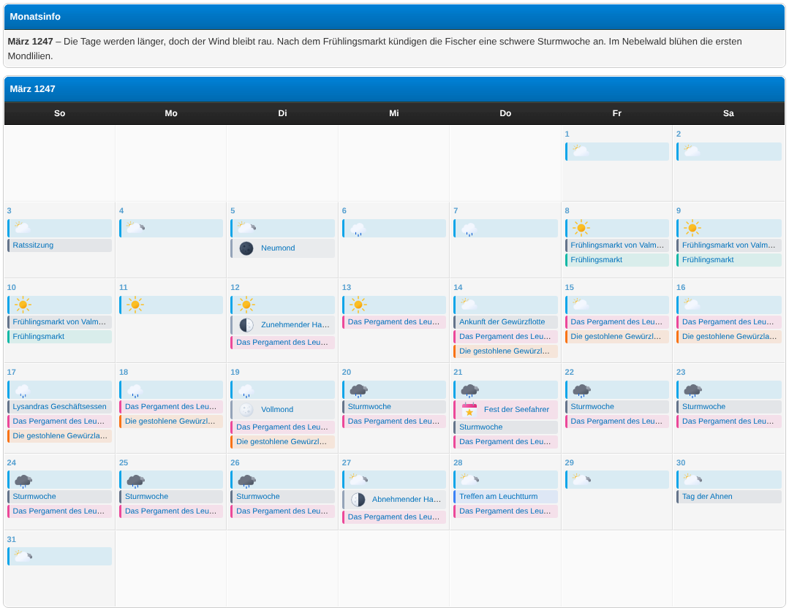
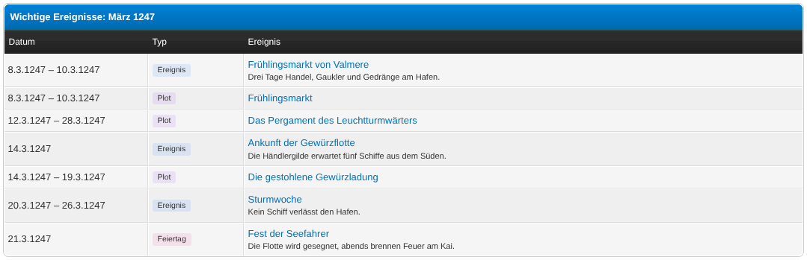
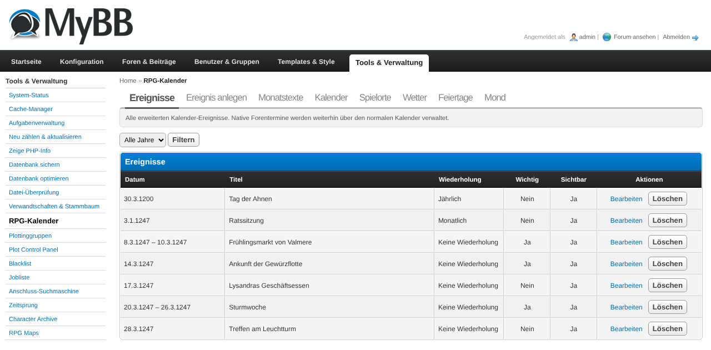
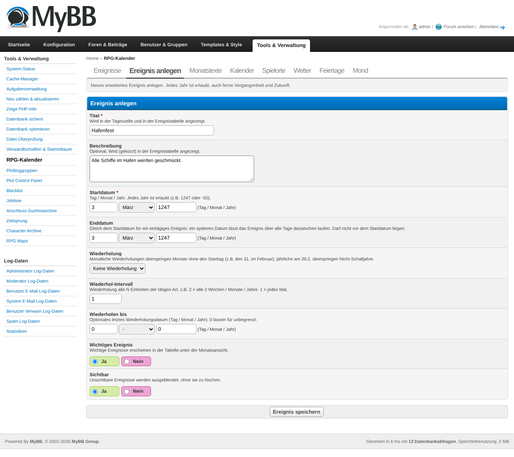
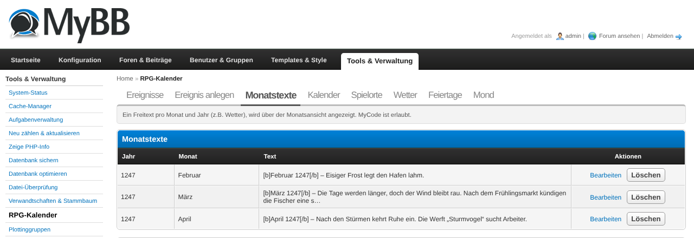

# RPG Calendar (rpgcalendar)

A MyBB 1.8 plugin that replaces the forum calendar view with a modern, minimalist month view
built for RPG forums. It merges four event sources into one grid:

- **Native MyBB events** – everything your members already entered keeps working and stays
  visible (read-only, managed through the normal calendar as before)
- **Extended events** – events in *any* year, e.g. 1247 or 3021 or -50 (the native calendar
  is limited to "current year + 5"), including multi-day spans and weekly/monthly/yearly repeats
- **Plots** – delivered automatically by a plot management plugin (e.g. Plot-CP) through a
  documented provider hook, no configuration needed
- **Birthdays** – from the native profile birthday or from a custom profile field
  (in-character birthdays that appear in every displayed year)
- **Weather & holidays per location** – define play locations in the ACP; for **real**
  locations the plugin generates real weather (Open-Meteo) and public holidays (Nager.Date)
  as editable entries, for **fictional** locations the team fills them in by hand. Each
  location's weather and holiday calendar can be recoloured or hidden per member on the
  *My calendars* page.
- **Moon calendar per location** – generate the four principal moon phases (new, waxing,
  full, waning) with no external API: **real** locations follow the real Earth moon, **fictional**
  locations use a freely configurable cycle length and reference date (a fantasy moon). Works for
  any year, including far past/future. Its own recolour/hide calendar per member.

Plus a free text per month + year (weather, moon phases, …) above the grid and a table of
all important events below it.

Members are not just viewers: from the day view they create their own events, invite other
members (who accept or decline by PM), and organise everything into personal or shared
**sub-calendars** with a colour they pick themselves and a show/hide toggle. Team groups can
publish forum-wide events for everyone.



## Requirements

- MyBB 1.8.x
- PHP 7.4 or 8.x
- No dependencies. The Plot-CP integration is optional and activates automatically once a
  provider plugin is installed.

## Installation

1. Upload all files from the archive into your MyBB root directory (the folder structure
   matches the forum structure: `rpgcalendar.php`, `inc/`, `admin/`).
2. Go to **ACP → Configuration → Plugins** and click **Install & Activate** next to
   *RPG Calendar*.
3. Go to **ACP → Configuration → Settings → RPG Calendar** and review the settings
   (see [Configuration](#configuration)).
4. Open `yourforum.tld/rpgcalendar.php` – the month view appears. If the *Rewrite header
   calendar link* setting is enabled, the calendar link in the forum header now points there
   automatically.

## Usage

### First steps after activation

1. **ACP → Configuration → Settings → RPG Calendar**: check *Native calendar ID* (the ID of
   the calendar whose events should be merged in; the default calendar of a fresh MyBB has
   ID 1) and set *Minimum/Maximum year* to the range your RPG plays in.
2. Open the calendar page once and use the month/year jump form to navigate to your RPG's
   current in-game month.
3. Optionally set *Default year* / *Default month* so the page opens on your in-game date
   instead of the real-world date.

### Managing extended events (Admin)

Path: **ACP → Tools & Maintenance → RPG Calendar**

- The **Events** tab lists all extended events with a year filter and pagination.
- **Add event** creates a new event:
  - *Title* – shown in the day cell and the important-events table
  - *Description* – optional, shown (shortened) in the important-events table
  - *Start date* – day / month / year; any year within the configured range is allowed
  - *Multi-day event* + *End date* – for events spanning several days (may cross month and
    year borders)
  - *Repeat* – none / weekly / monthly / yearly, with an optional *Repeat until* date.
    Conventions: a monthly event on the 31st skips months without a 31st; a yearly event
    on Feb 29 only occurs in leap years.
  - *Important event* – important events are listed in the table below the month view
  - *Visible* – hide an event without deleting it
- **Edit** / **Delete** are available in the list. Deleting asks no questions – it is a
  single event row, re-create it if needed.

Native forum events are *not* edited here – they are managed through the normal MyBB
calendar like before, and rpgcalendar displays them read-only (with a link to the native
event page).

### Month texts (Admin)

Path: **ACP → Tools & Maintenance → RPG Calendar → Month texts**

One free text per month + year, shown in a box above the grid – ideal for weather, moon
phases or a short summary of what is going on in your world that month. MyCode is allowed,
HTML is not. Saving a text for a month that already has one overwrites it.

You can **pre-fill** the text from a location's weather and holidays: pick a location, month
and year in the *Pre-fill from weather / holidays* box, click *Generate suggestion*, then
review and save the generated text.

### Locations, weather & holidays (Admin)

Path: **ACP → Tools & Maintenance → RPG Calendar → Locations / Weather / Holidays**

Every play location exposes two calendars – **weather** and **holidays** – that appear on the
*My calendars* page like any other calendar, so each member can recolour them or hide them
(see [My calendars and colours](#my-calendars-and-colours)).

1. **Locations** – *Add location* with a name and a type:
   - **Real (world)** – enter an ISO country code (e.g. `DE`, `GB`, `US`) for holidays and a
     city (or coordinates) for weather. On the location list, use *Generate* with a year range
     to fetch real weather and holidays and store them as editable entries. Coordinates are
     looked up automatically from the city on the first run. *Generate* again to refresh; it
     replaces previously generated entries but keeps any you edited or added by hand.
   - **Fictional** – no generation. When a fictional location has no data for the shown month,
     the calendar shows a hint asking the team to add weather/holidays by hand.
2. **Weather** – manual weather entries (location, condition, date range, optional yearly
   pattern, optional note). Generated entries appear here too and can be edited (editing one
   converts it to a manual entry so the next *Generate* keeps it).
3. **Holidays** – manual holidays (location, title, date, optional *every year*). Holidays
   also appear in the important-events table below the grid. Generated holidays are translated
   to the board's default language and get a short Wikipedia description, a link to the full
   Wikipedia article and a note whether it is a statutory day off (all editable afterwards).
   The Wikipedia enrichment can be turned off with the *Enrich generated holidays with
   Wikipedia* setting – then only the plain holiday name and the day-off note are stored.

**Weather icons:** each weather condition is a WMO weather code, so there is one image per
code, named after the code (`0.svg`, `61.svg`, `95.svg`, … – e.g. `61.svg` for light rain).
The plugin ships a default icon set in *Weather image directory* and shows the matching image
on the weather chip; if none is found it shows the localized condition text. For more variety
you can add several images per code with a dash suffix (`61.svg`, `61-1.svg`, `61-night.svg`,
…); one is picked per weather entry and stays stable on reload. In addition to the codes there
is a derived `windy` condition: when generating, a day whose maximum wind speed reaches the
*Windy threshold* setting is marked `windy` (image `windy.svg`) instead of its weather code.
**Holiday symbol:** set one symbol (emoji or image URL) shown in front of every holiday. Ships
with a default calendar-star icon (`inc/plugins/rpgcalendar/assets/holiday/calendar-star.svg`)
drawn to match the weather icon set.

In a day cell, weather and moon are shown on top, holidays below them, then the other events.
Weather, moon and holiday chips are clickable and open a small detail page with a short
description (location, temperature for weather; the phase for the moon; the Wikipedia
description and a link to the full article for holidays).

### Moon calendar (Admin)

Path: **ACP → Tools & Maintenance → RPG Calendar → Locations / Moon**

The moon calendar is per location and needs **no external service** – phases are computed
locally, so they exist for **any year** (unlike weather, which is bound to the real-data range).

1. On the **location** form, turn **Moon calendar** on. Then:
   - **Real** locations follow the real Earth moon automatically (the cycle/reference fields are
     ignored).
   - **Fictional** locations use the **Cycle length** (days) and a **Reference phase** – pick a
     date on which a *new* or *full* moon occurs; that anchors the whole cycle. This is how you
     build a fantasy moon (e.g. a 28-day or 40-day cycle).
2. On the location list, use **Generate** with a year range. The form has a **checkbox per
   source** (weather / holidays / moon) – tick only what you want to (re)generate. Each source
   replaces only its own generated entries, so you can refresh the moon without re-generating
   hand-edited holidays. For the moon, any moon-enabled location (real or fictional) gets its
   four principal phases – **new moon, waxing half moon, full moon, waning half moon** – stored
   as editable entries. *Generate* again to extend/refresh; it keeps anything you edited or added
   by hand.
3. The **Moon** tab lists all phases and lets you add or edit them by hand (editing a generated
   entry converts it to manual so the next *Generate* keeps it), filter by location, and bulk-
   delete all generated entries.

**Moon icons:** one image per phase, named after the phase (`new`, `waxing`, `full`, `waning`),
in the *Moon image directory*. A default set ships with the plugin; if no image is found the
localized phase text is shown. Dash-suffixed variants work like the weather icons. Each moon-
enabled location exposes a `moon` calendar on the *My calendars* page, so members recolour or
hide it like any other.

> Accuracy note: real-location phases use a mean synodic cycle (~29.53 days), so a phase may
> land up to about a day off the exact astronomical instant – fine for calendar use.

#### Data sources & privacy

For real locations the server makes outbound HTTPS requests **only when you click Generate**
(never on a normal page view): to **Open-Meteo** (`open-meteo.com`) for weather and
**Nager.Date** (`date.nager.at`) for public holidays, plus Open-Meteo geocoding to turn a city
into coordinates, plus **Wikipedia** (`<lang>.wikipedia.org`, in the board's default language)
to translate each holiday's name and fetch a short description. Only the location data you
entered (city, country, coordinates) and the holiday names are sent – no member data. All
services are free and need no API key. Because real weather only exists for
real dates, weather uses the archive for past days, the forecast for the next ~16 days, and
climate normals further out; the in-game calendar date is treated as the real date.

### Global calendars (Admin)

Path: **ACP → Tools & Maintenance → RPG Calendar → Calendars**

Here you manage the **global sub-calendars** that appear for every member:

- *Name* and *Default colour* – the fallback colour a calendar has until a member picks
  their own colour for it on the frontend.
- *Joinable*:
  - **No** – a public calendar visible to everyone; team members write to it.
  - **Yes** – members can self-subscribe (join) to it and add their own events; only
    subscribers see it. Good for opt-in categories (e.g. "Quidditch", "Events").
- Deleting a global calendar moves its events to the built-in *Forum* calendar; nothing is
  lost.

Members create their own **personal** calendars on the frontend (see below) – those never
appear here.

### Birthdays

Two sources, selected by the *Birthday source* setting:

- **0 (default)**: the native profile birthday. Shown only when the displayed year is close
  to the real current year (*Birthday year range* setting), because real birthdays make no
  sense in the year 1247. The age is only shown in the real current year.
- **Profile field ID**: a custom profile field containing an in-character birthday in the
  format `day-month-year` (e.g. `12-3-1200`) or `day-month`. These birthdays appear in
  *every* displayed year from the birth year onwards, with the age computed against the
  displayed year – perfect for character birthdays in an RPG timeline.

### Day view and creating events (members)

Any logged-in member can create events directly on the frontend:

1. On the month view, click a day number to open its **day view** (`rpgcalendar.php?action=day&…`),
   which lists every event on that day.
2. Click **Add event**. The form offers:
   - *Title* and *Description*
   - *Start date*, *Multi-day* + *End date*
   - *Repeat* (weekly/monthly/yearly) with a *Repeat interval* (e.g. every 2 weeks) and an
     optional *Repeat until* date
   - *Important* – also list it in the month's important-events table
   - *Calendar* – which of your sub-calendars the event belongs to (see below)
   - *Forum-wide* – **team groups only**: make the event visible to everyone. Members who are
     not in a team group can only create personal events for themselves.
   - *Invite members* – start typing a username and pick from the suggestions
3. **Edit** and **Delete** appear on events you own (or may edit through a shared calendar).

Which groups count as "team" is controlled by the *Team groups* setting.

### Invitations

When you add usernames under *Invite members*, each invited member:

- receives a **PM** with a link to the event,
- sees the event on their own calendar,
- and can **Accept** or **Decline** on the event page.

The event page shows every invitee's status (pending / accepted / declined).

### My calendars and colours

Path: the **My calendars** link on the calendar page (`rpgcalendar.php?action=calendars`)

Every member has a personal calendars page where they can:

- **Create personal calendars** (e.g. "My character", "Guild") that only they and invited
  members see.
- Pick a **colour** and a **show/hide** state *per calendar* – this is stored per user, so
  your colours never affect anyone else. This includes global calendars and the built-in
  **Birthdays** calendar.
- **Join** any global calendar an admin marked as *joinable*.

### Sharing a calendar

From **My calendars → Share**, you can share one of your calendars with other members:

- **Viewer** – may only see the calendar and its events.
- **Editor** – may also add and edit events in it.

The member receives a **PM** to accept or decline the invitation; pending and accepted
members are listed on the share page. Either side can remove the share later, and a member
can **Leave** a calendar that was shared with them.

### Navigating (members)

Members open the calendar (header link or `rpgcalendar.php`) and navigate months with the
‹ › links or the month/year jump form. Private native events stay private, and members can
still add events through the native MyBB calendar as before.

## Configuration

Path: **ACP → Configuration → Settings → RPG Calendar**

| Setting | Meaning |
|---|---|
| Enable RPG Calendar | Master switch for the frontend page |
| Rewrite header calendar link | Points the calendar link in the header to rpgcalendar.php (runtime rewrite, fully reversible by disabling) |
| Link rewrite templates | Comma-separated template names in which `calendar.php` links are rewritten. Default `header_menu_calendar` (the MyBB standard). Themes with custom headers can add their own template names here – no template edit needed |
| Allowed user groups | Who may view the calendar page (none selected = everyone) |
| Native calendar ID | The native calendar whose events are merged in; its "start of week" is reused |
| Show native events | Merge native events (technically limited to years 1970–2037) |
| Show birthdays | Show birthdays in the grid |
| Birthday source | 0 = native profile birthday, otherwise the fid of a custom profile field |
| Birthday year range | For the native source only: max. distance from the real current year |
| Minimum / Maximum year | Navigation and input limits |
| Default year / month | Start view when opened without parameters; 0 = real today |
| Weather image directory | Board-relative folder with weather images named after the WMO weather code (`0.svg` … `99.svg`, plus `windy.svg`). Ships with a default icon set |
| Windy threshold (km/h) | When generating, a day with max wind speed ≥ this value is marked `windy` instead of its weather code (0 = off) |
| Moon image directory | Board-relative folder with moon-phase images named after the phase (`new`, `waxing`, `full`, `waning`), dash-suffixed variants supported. Ships with a default icon set |
| Holiday symbol | One symbol for all holidays: an emoji/short text or an image URL. Ships with a default calendar-star icon that matches the weather set |
| Enrich generated holidays with Wikipedia | Translate generated holiday names and add a short description + article link from Wikipedia. Off = plain name and day-off note only |
| Show missing-data hint | Show the "please add data" hint for fictional locations without data |
| Team groups | User groups whose members may create forum-wide events from the day view. Everyone else can only create personal events and invite individual members. Empty = only admins publish forum-wide events |
| Current in-play months | Comma-separated `year-month` tokens (e.g. `1487-3, 1487-4`) whose month texts are collected into the global template variable `{$rpgcalendar_current_monthtexts}` (usable in templates and forum/category descriptions). Empty disables the variable (no query overhead) |
| Allow HTML in event titles | Render HTML in event titles instead of escaping it. Only enable on calendars where you trust everyone who can create events – on public calendars this lets those users inject markup |

## Integration for plot plugins (Plot-CP)

rpgcalendar fires a provider hook once per rendered month. Any plugin can deliver events –
they appear in the grid and (by default) in the important-events table with a `plot` badge:

```php
$plugins->add_hook('rpgcalendar_collect_events', 'plotcp_rpgcalendar_collect');

function plotcp_rpgcalendar_collect(array &$args)
{
    // $args = ['year' => 1247, 'month' => 3, 'events' => [...]]
    // load your plots overlapping that month, then append:
    $args['events'][] = [
        'id'        => 'plot-' . $plot_id,      // unique string id
        'source'    => 'plot',
        'title'     => $plot_title,             // raw text, rpgcalendar escapes it
        'url'       => 'plotcp.php?action=view&pid=' . $plot_id,  // optional
        'start'     => ['y' => 1247, 'm' => 3, 'd' => 12],
        'end'       => ['y' => 1247, 'm' => 4, 'd' => 2],  // optional, >= start
        'important'     => true,                // optional, default true
        'badge'         => 'plot',              // optional CSS badge suffix
        'calendar_key'  => 'plotcat-5',         // optional: assign to a virtual sub-calendar
        'default_color' => '#a855f7',           // optional: #rrggbb, user preference overrides it
    ];
}
```

Contract guarantees:

- The hook fires exactly once per month render with `year`, `month`, `events`.
- Events outside the requested month are ignored – providers may over-deliver.
- Escaping is done by rpgcalendar at render time – deliver raw titles.
- Malformed entries are silently discarded; a broken provider never breaks the page.
- Only `http(s)` or relative URLs are accepted.

### Virtual sub-calendars (optional)

A provider may also expose its own **sub-calendars** – for example one per plot category –
so they show up on every member's *My calendars* page with a per-user colour and show/hide
toggle. Register the additional hook:

```php
$plugins->add_hook('rpgcalendar_collect_calendars', 'plotcp_rpgcalendar_calendars');

function plotcp_rpgcalendar_calendars(array &$args)
{
    $args['calendars'][] = [
        'key'           => 'plotcat-5',   // must NOT start with the reserved 'cal-'
        'name'          => 'Plots',
        'default_color' => '#a855f7',
    ];
}
```

Events reference the same calendar via `calendar_key`. rpgcalendar's own birthdays are the
built-in virtual calendar `birthdays`.

There is also an output hook `rpgcalendar_monthview_end`
(`['year' => int, 'month' => int, 'output' => &$html]`) to append content below the
important-events table.

## Calendar math (important to know)

- All dates use the **proleptic Gregorian calendar** with astronomical year numbering
  (year 0 exists, negative years are allowed). Historical Julian dates before 1582 are not
  converted – this is a deliberate simplification for fictional RPG timelines.
- A monthly repeat on day 31 skips shorter months (no shifting to the 30th).
- A yearly repeat on Feb 29 occurs only in leap years (no shifting to Feb 28).

## Uninstallation

1. **ACP → Configuration → Plugins → RPG Calendar → Deactivate** (removes templates,
   settings and the stylesheet).
2. Click **Uninstall** (drops all plugin tables: `rpgcalendar_events`,
   `rpgcalendar_monthtexts`, `rpgcalendar_event_invites`, `rpgcalendar_calendars`,
   `rpgcalendar_calendar_members`, `rpgcalendar_calendar_prefs`, `rpgcalendar_locations`,
   `rpgcalendar_weather`, `rpgcalendar_holidays`, `rpgcalendar_moonphases` – your extended
   events, calendars, invitations, month texts, locations, weather, holidays and moon phases
   are deleted; native calendar data is never touched).
3. Delete the uploaded files (`rpgcalendar.php`, `inc/plugins/rpgcalendar.php`,
   `inc/plugins/rpgcalendar/`, `admin/modules/tools/rpgcalendar.php`, the language files).

## Screenshots







## Changelog

See [CHANGELOG.md](CHANGELOG.md).
